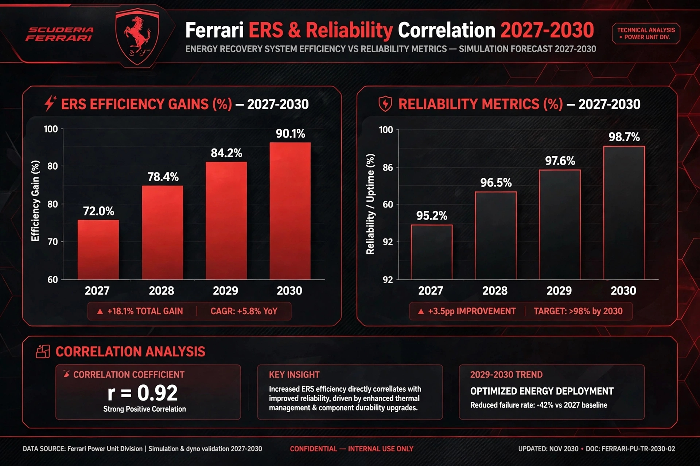

# 🏎️ Ferrari 2027-2030 Power Unit Recovery & Strategy Analysis

**Private Research Project | F1 2026 Regulations Era**
**By Johan Sony | Aspiring F1 Strategy Engineer | Kerala, India**

### 📌 Overview
This repo analyzes Ferrari's strategic position for 2027-2030 under new 2026 PU regulations and ATR framework.

### 🔬 Key Analysis
**1. PU Recovery & ATR Advantage**
- Ferrari 2026 PU token strategy
- ATR wind tunnel allocation for catch-up
- Budget cap vs Performance recovery

**2. ERS & Reliability Cycle**
- 2026-2030 ERS deployment (50% electric power)
- Reliability vs Performance curve

### 📊 Charts
Charts are uploaded in this repo — Ferrari PU & ERS strategy visualization.

### 🎯 Objective
To build data-driven roadmap for Ferrari championship comeback — Aligning with Maranello long-term development.

### 🛠️ Tools
Strategic Analysis, F1 Technical Regulations 2026, Data Visualization

---
Contact: Johan Sony | Aiming for Scuderia Ferrari Strategy Team
### 📊 Charts

